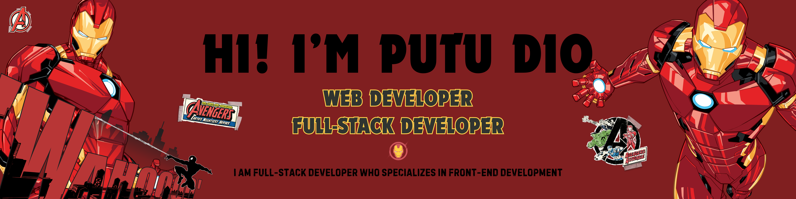
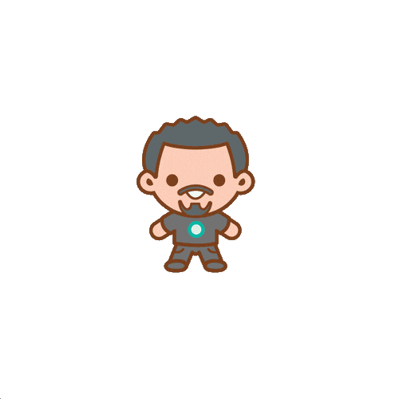
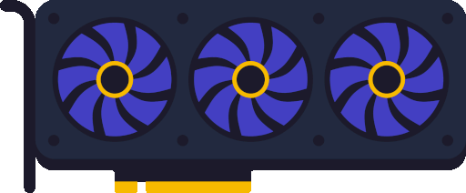
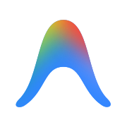
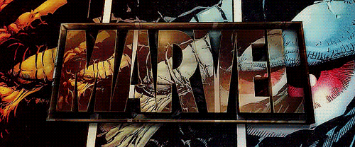

<!-- HEADER BANNER -->

  

 

  Information Systems graduate with a strong interest in web development, cybersecurity, and modern digital technologies.
  I specialize in Fullstack Web Development with a primary focus on Frontend Engineering, building responsive, user-friendly, and reliable web applications.
  My experience includes developing monitoring systems, dashboard applications, and digital solutions that help organizations improve service reliability, security, and user experience.

 

<h3>📚 About Me</h3>

- 🎓 Information Systems Graduate passionate about technology and digital innovation
- 💻 Fullstack Web Developer with a strong focus on Frontend Development
- 🛡️ Developed an External Website Monitoring Dashboard for public service websites during an internship at Denpasar City Communication and Informatics Office (Diskominfo)
- 🔍 Implemented monitoring for website uptime, HTTP errors, SSL expiration, content modifications, and defacement incidents
- 📊 Experienced in dashboard development, system monitoring, API integration, and database management
- 🚀 Passionate about building modern, responsive, and user-centered web applications
- 🌱 Continuously learning through personal projects, open-source resources, and emerging technologies
- 🧩 Enjoy transforming complex problems into clear, scalable, and maintainable solutions
- 🤝 Comfortable working independently and collaboratively in team environments

 

<h3>🌿 What I'm Building Toward</h3>

<table>
<tr>
<td width="50%" valign="top">

**🌱 Direction**

- Building modern and reliable web applications
- Creating solutions that improve user experience and operational efficiency
- Developing secure and maintainable digital systems
- Combining frontend excellence with robust backend architecture

</td>

<td width="50%" valign="top">

**🔭 Current Focus**

- Next.js, React, TypeScript, and modern frontend architecture
- Fullstack web application development
- Website monitoring and cybersecurity awareness
- API integration, databases, and system optimization

</td>
</tr>
</table>

<!-- TECH STACK SECTION -->

  <h3>TACTICAL TECH STACK</h3>
   
  
  
Tools and technologies I use to assemble digital solutions:

   

<table  align="center" width="100%">
  <colgroup>
    <col width="50%" />
    <col width="50%" />
  </colgroup>
  <tr>
    <td width="50%" valign="top">
      <h3>Frontend Languages</h3>
      

        
      

    </td>
    <td width="50%" valign="top">
      <h3>Backend Languages</h3>
      

        
      

    </td>
  </tr>
  <tr>
    <td width="50%" valign="top">
      <h3>Database &amp; Data Storage</h3>
      

        
      

    </td>
    <td width="50%" valign="top">
      <h3>Frameworks &amp; Libraries</h3>
      

        
      

    </td>
  </tr>
  <tr>
    <td width="50%" valign="top">
      <h3>IDE &amp; Code Editors</h3>
      

        
        
      

    </td>
    <td width="50%" valign="top">
      <h3>Development Tools &amp; DevOps</h3>
      

        
      

    </td>
  </tr>
</table>
  

 
<!-- STATS SECTION -->

  <h3>Stark Industries Telemetry & Stats</h3>
  

 

<!-- MINI GAMES & CONTRIBUTION GRAPH -->

  <h2>Arcade & Contribution Grid</h2>
  
Watch the contribution bots in action:

   

  <!-- Snake Animation -->
  

    

  <!-- Pacman Contribution Graph -->
  <picture>
    <source media="(prefers-color-scheme: dark)" srcset="https://raw.githubusercontent.com/PutuDio/PutuDio/pacman-output/pacman-contribution-graph-dark.svg">
    <source media="(prefers-color-scheme: light)" srcset="https://raw.githubusercontent.com/PutuDio/PutuDio/pacman-output/pacman-contribution-graph.svg">
    
  </picture>

 

<!-- SOCIALS & CONTACT -->

  <h2>Establish Connection</h2>
  
Need a developer for your next mission? Let's connect.

  
  

 

