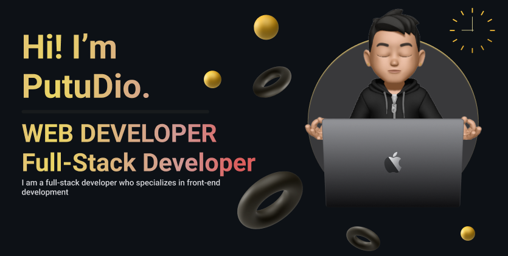

<!-- HEADER BANNER -->

  

 

  Information Systems graduate with a strong interest in web development, cybersecurity, and modern digital technologies.
  I specialize in Fullstack Web Development with a primary focus on Frontend Engineering, building responsive, user-friendly, and reliable web applications.
  My experience includes developing monitoring systems, dashboard applications, and digital solutions that help organizations improve service reliability, security, and user experience.

  

### 🌿 What I'm Building Toward

<table>
<tr>
<td width="50%" valign="top">

**🌱 Direction**

- Building modern and reliable web applications
- Creating solutions that improve user experience and operational efficiency
- Developing secure and maintainable digital systems
- Combining frontend excellence with robust backend architecture

</td>

<td width="50%" valign="top">

**🔭 Current Focus**

- Next.js, React, TypeScript, and modern frontend architecture
- Fullstack web application development
- Website monitoring and cybersecurity awareness
- API integration, databases, and system optimization

</td>
</tr>
</table>

<!-- TECH STACK SECTION -->

  <h2>Tactical Tech Stack</h2>
  
Tools and technologies I use to assemble digital solutions:

   

  <!-- Frontend -->
  <h3>Frontend (The Interface)</h3>
  
  &nbsp;&nbsp;
  
  &nbsp;&nbsp;
  
  &nbsp;&nbsp;
  
  &nbsp;&nbsp;
  
  
    

  <!-- Backend & Database -->
  <h3>Backend & Database (The Arc Reactor)</h3>
  
  &nbsp;&nbsp;
  
  &nbsp;&nbsp;
  
  &nbsp;&nbsp;
  

    

  <!-- Tools & Design -->
  <h3>Workspace & Design (The Workshop)</h3>
  
  &nbsp;&nbsp;
  
  &nbsp;&nbsp;
  

    

  <!-- AI Assistants -->
  <h3> AI Protocols (J.A.R.V.I.S Assistants)</h3>
  
  &nbsp;&nbsp;
  

 

<!-- STATS SECTION -->

  <h2>Stark Industries Telemetry & Stats</h2>
   
  

 

<!-- MINI GAMES & CONTRIBUTION GRAPH -->

  <h2>Arcade & Contribution Grid</h2>
  
Watch the contribution bots in action:

   

  <!-- Snake Animation -->
  

    

  <!-- Pacman Contribution Graph -->
  <picture>
    <source media="(prefers-color-scheme: dark)" srcset="https://raw.githubusercontent.com/PutuDio/PutuDio/pacman-output/pacman-contribution-graph-dark.svg">
    <source media="(prefers-color-scheme: light)" srcset="https://raw.githubusercontent.com/PutuDio/PutuDio/pacman-output/pacman-contribution-graph.svg">
    
  </picture>

 

<!-- SOCIALS & CONTACT -->

  <h2>Establish Connection</h2>
  
Need a developer for your next mission? Let's connect.

  
  

 
